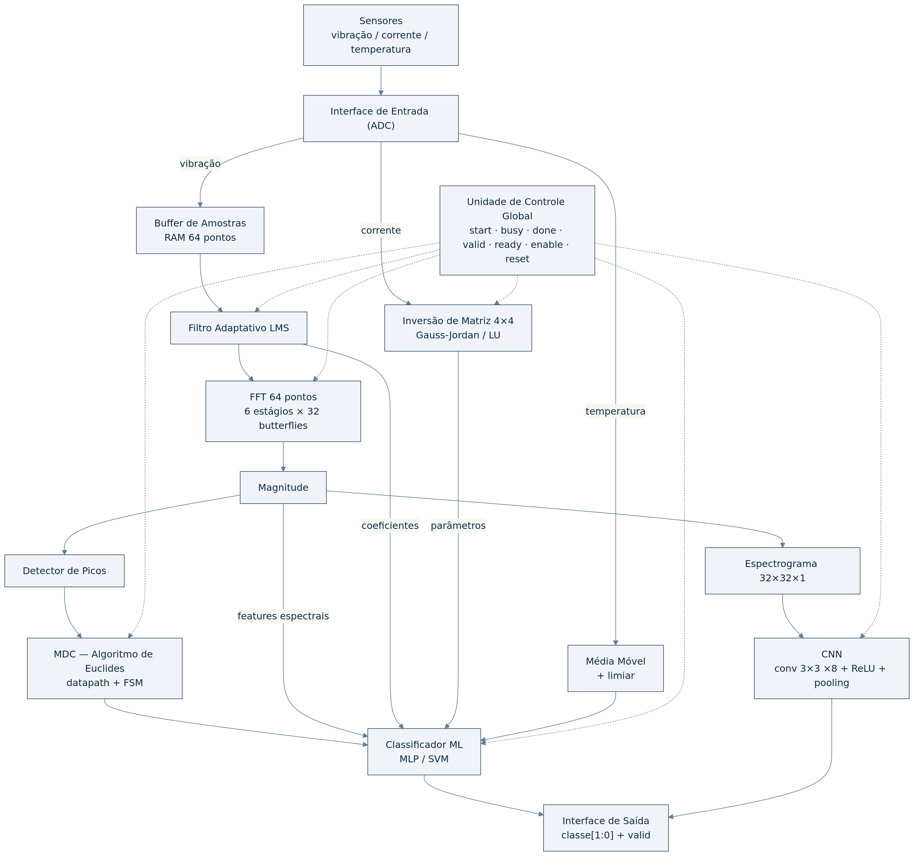

# SMMA: monitoramento de motores elétricos em FPGA

O SMMA (Smart Machine Monitoring Accelerator) recebe os sinais de vibração, corrente das três fases e temperatura de um motor elétrico e diz, direto na FPGA, se o motor está normal ou se tem desbalanceamento, desalinhamento ou desgaste de rolamento. Fizemos o projeto em equipe no PBL de Circuitos Digitais IV do Programa CI Digital (CEPEDI), entre julho e setembro de 2026. Ele foi gravado e testado numa placa DE0-CV (Cyclone V).

## Equipe

| Nome | GitHub |
|---|---|
| Gabriel Sena Barbosa Silva | [@Gabriel-SBS](https://github.com/Gabriel-SBS) |
| Jair Rocha Souza | [@jairsdev](https://github.com/jairsdev) |
| João Vítor Cedraz Carneiro | [@JvCedrazC](https://github.com/JvCedrazC) |
| Luiz Augusto dos Santos Oliveira | [@guto7191](https://github.com/guto7191) |
| Tássio Carvalho Rodrigues | [@tassiocarvalho](https://github.com/tassiocarvalho) |

## Como funciona



As amostras chegam a 25,6 kHz em cinco canais e seguem por três ramos que rodam em paralelo:

- **Vibração.** Um decimador CIC reduz a taxa em 32 vezes, sem multiplicador, para que os 64 pontos da FFT cubram 80 ms e cada bin tenha 12,5 Hz. A FFT radix-2 usa uma única butterfly, reaproveitada nos 6 estágios, e as duas memórias que o enunciado permite. Depois dela, um detector acha os dois maiores picos, o MDC por Euclides estima o bin da frequência fundamental e o extrator tira as características do espectro. Um filtro LMS de 8 coeficientes roda em paralelo sobre o sinal bruto, e o RMS do erro dele também vira característica.
- **Corrente.** Calcula o RMS de cada fase e o índice de desequilíbrio. Só quando esse índice cai numa faixa duvidosa o ramo pede a FFT emprestada ao ramo de vibração para olhar as harmônicas.
- **Temperatura.** Média e máximo por janela, só com somador e comparador.

As características alimentam dois blocos. A **árvore de decisão** classifica o motor usando apenas comparadores, sem nenhum multiplicador. O **estimador de parâmetros** resolve um sistema 4×4 com inversão de matriz por Gauss-Jordan.

Todos os módulos usam o mesmo handshake (`start`, `busy`, `done`, `valid`, `ready`, `enable`, `reset`), e quem produz um dado só o descarta depois que o consumidor confirma com `ready`. A representação é em ponto fixo: Q1.15 para os sinais e Q4.12 dentro da inversão de matriz, onde os valores intermediários passam de 1.

Há também uma CNN para espectrogramas 32×32 (`spectrogram_cnn_area.v`), com um único multiplicador compartilhado entre as camadas. O datapath dela foi verificado bit a bit contra uma convolução de referência, mas os pesos ainda são zeros, porque a rede não foi treinada.

## Resultados

Síntese no Quartus Prime 25.1 Lite para o Cyclone V 5CEBA4F23C7:

| Recurso | Uso |
|---|---|
| Lógica | 3.887 ALMs de 18.480 (21 %) |
| Registradores | 5.081 |
| Memória | 81 blocos M10K de 308 (26 %) |
| DSP | 9 de 66 (14 %) |
| Timing a 50 MHz | fecha nos 4 cantos; folga de setup de 2,58 ns no modelo lento a 85 °C |

Em 12/09/2026 gravamos o projeto numa DE0-CV. Os quatro parâmetros mecânicos mostrados nos displays de 7 segmentos saíram idênticos, bit a bit, aos da simulação.

No dataset, o classificador acerta 73,9 % das janelas. O recall de rolamento é de 100 %, e o das outras classes fica entre 53 % e 59 %. O `docs/projeto.md` conta como chegamos a esse número, incluindo duas recalibrações que foram necessárias depois de bugs achados na integração.

## Testes

São 38 testbenches em `quartus/smma_fft64/tb/`. Eles cobrem cada módulo isolado, o sistema completo com dados reais de cada classe e a entrada pela serial. Rodamos a suíte no Cadence Xcelium durante o projeto. Ela também roda no Icarus Verilog 12; o resultado no Icarus está abaixo.

No Icarus Verilog 12, 37 dos 38 testbenches terminam com PASS. O que falta é o `tb_de0cv_4estados`, que simula 400 ms de placa e não acabou dentro do limite de 10 minutos que demos a cada teste. Não chegou a falhar, só é lento demais para o Icarus. No `tb_smma_top_0nm_bpfo_10`, o simulador avisa que não encontrou `corrente_fase_b.hex` e `corrente_fase_c.hex` da classe BPFO. Esses dois arquivos não foram gerados na conversão do dataset. Mesmo assim, o teste classifica as duas janelas como desgaste de rolamento e passa.

Para rodar um testbench no Icarus, a partir de `quartus/smma_fft64/`:

```bash
iverilog -g2012 -o sim -s tb_smma_top rtl/*.v tb/tb_smma_top.v && vvp -n sim
```

Os testbenches do sistema completo leem os dados de `../../dataset_convertido/`, por isso precisam ser executados dessa pasta.

## Na placa (DE0-CV)

Abra `quartus/smma_fft64/smma_fft64.qpf`, compile e grave. Depois:

1. `SW[0]` para cima (enable).
2. Aperte e solte `KEY[0]` (reset) e depois `KEY[1]` (start).
3. Cerca de 80 ms depois, `LEDR[5]` acende e `LEDR[3:0]` mostra a classe da janela que está gravada no bitstream.
4. `SW[2:1]` escolhe qual dos quatro parâmetros aparece em `HEX3..HEX0`.

Também dá para mandar uma janela nova pela serial, com um conversor USB-TTL de 3,3 V e o `scripts/send_window_serial.py`. Essa parte funciona em simulação, mas ainda não foi testada na placa. O passo a passo está em `docs/entregavel_6_7_fpga.md`.

## O que ainda falta

- A janela de vibração dura 80 ms, e não os 10 ms do enunciado. Foi uma escolha: com 10 ms não dá para separar a frequência de rotação do motor, que fica perto de 50 Hz.
- A matriz do estimador de parâmetros é carregada de fora e não está calibrada, porque o dataset não tem um rótulo contínuo de severidade para calibrar.
- Os limiares da faixa duvidosa do ramo de corrente ainda são valores provisórios.
- A CNN não tem pesos treinados.

## Pastas

| Pasta | Conteúdo |
|---|---|
| `quartus/smma_fft64/rtl/` | os módulos Verilog |
| `quartus/smma_fft64/tb/` | testbenches |
| `quartus/smma_fft64/reports/` | resumos de síntese e timing |
| `quartus/smoke_test/` | projeto mínimo usado para testar a placa |
| `scripts/` | conversão do dataset, calibração do classificador e envio pela serial (Python) |
| `dataset_convertido/`, `dataset_calib/` | janelas do dataset convertidas para `.hex` em Q1.15 |
| `docs/` | entregáveis do PBL, decisões de projeto (`projeto.md`), resumo dos módulos, respostas às perguntas da banca e relatórios das sessões tutoriais |

## Dados

Os sinais vêm do dataset público de máquina rotativa do KAIST (vibração, corrente, temperatura e acústica sob diferentes cargas e falhas), convertidos para ponto fixo pelos scripts em `scripts/`. Os arquivos originais não estão neste repositório.
