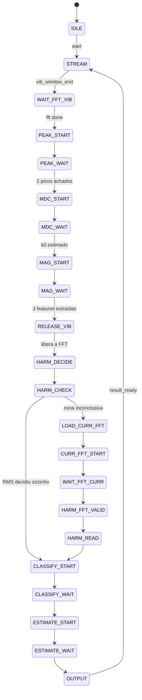

# Entregáveis §6.2, §6.3, §6.4 e §6.8

Documento único para quatro entregáveis do §6 do enunciado. Estão juntos de propósito: os quatro descrevem **os mesmos módulos sob ângulos diferentes** (mapeamento, controle, formato numérico e decisão de projeto), e separá-los obrigaria a repetir as mesmas tabelas de ciclos e recursos quatro vezes.

**Todos os números de recursos abaixo foram medidos**, não estimados: vêm da tabela "Analysis & Synthesis Resource Utilization by Entity" do `quartus_map` real sobre o projeto completo (`smma_top_de0cv`, Cyclone V 5CEBA4F23C7), não de síntese isolada de módulo nem de cálculo teórico. Onde um número é derivado por geometria (contagem de operações), está dito explicitamente.

---

# §6.2 — Mapeamento algoritmo-arquitetura

Para cada algoritmo: pseudocódigo, fluxo de dados, datapath, unidade de controle, operações por ciclo, ciclos e recursos.

## 6.2.1 MDC — Algoritmo de Euclides subtrativo (`mdc_euclides.v`)

**Pseudocódigo**

```
função mdc(a, b):
    se a == 0 ou b == 0: retorna 0        # guarda: 0 não tem MDC útil aqui
    enquanto a != b:
        se a > b: a <- a - b
        senão:    b <- b - a
    retorna a
```

**Fluxo de dados**

```
 a_in ──►[reg a]──┬──►(comparador a>b)──► seleção
                  │                          │
 b_in ──►[reg b]──┴──►(subtrator único)◄─────┘
                          │
                          └──► escreve de volta em a OU em b
```

**Datapath** — 2 registradores de 6 bits (`a`, `b`), **1 único subtrator** e 1 comparador. Não há divisor: essa é a razão de escolher Euclides *subtrativo* em vez do clássico com resto, que exigiria uma divisão por iteração. O mesmo subtrator serve aos dois ramos (`a-b` e `b-a`), selecionado por mux — mesma filosofia de reúso de operador da FFT e do LMS.

**Unidade de controle** — FSM de 4 estados: `S_IDLE` → `S_RUN` (itera) → `S_DONE` (aguarda `ready`) → `S_IDLE`. Handshake `start`/`busy`/`done`/`valid`/`ready`, idêntico ao resto do projeto.

**Operações por ciclo** — 1 comparação + 1 subtração por ciclo, em `S_RUN`.

**Ciclos** — depende dos operandos: no melhor caso 1; no pior caso relevante (operandos muito distantes, ex. 63 e 1) ~63. Os operandos aqui são índices de bin da FFT (1..31), então o pior caso real é limitado a ~31 ciclos — desprezível frente aos 80 ms de janela.

**Recursos medidos** — 37 ALUTs, 22 registradores, **0 DSP**.

> Alternativa avaliada e descartada: `mdc_binario.v` (algoritmo de Stein). Medido: vence só no pior caso de operandos distantes (4,9× mais rápido), mas custa 2,4× mais área e empata ou perde para operandos próximos — que é o caso real aqui. Ver `projeto.md`.

## 6.2.2 FFT de 64 pontos (`fft64_core.v`, `fft64_butterfly.v`, `fft64_twiddle_rom.v`)

**Pseudocódigo** — radix-2, decimação no tempo (DIT), iterativa

```
carrega x[0..63] em memória, em ordem de BITS INVERTIDOS
para estágio s de 0 a 5:                       # log2(64) = 6 estágios
    span <- 2^s
    para cada par (i, i+span) do estágio:      # 32 pares por estágio
        W <- twiddle[k(s,i)]
        t <- W * X[i+span]                     # 1 multiplicação complexa
        X[i+span] <- (X[i] - t) / 2            # escala 1/2 incondicional
        X[i]      <- (X[i] + t) / 2
retorna X[0..63]
```

**Fluxo de dados**

```
 wr_data ──►[RAM re/im 64×16]◄──────────────┐
                  │                          │
                  ├──► a (X[i]) ─────┐       │
                  └──► b (X[i+span]) ┤       │
                                     ▼       │
 twiddle_rom ──► W ──►[butterfly: 4 mult + 2 somas + escala 1/2]
                                     │       │
                                     └───────┘ escreve de volta
```

**Datapath** — memórias separadas para parte real e imaginária (64×16 bits cada), **1 única instância de butterfly** reaproveitada, e a ROM de 32 twiddles. O butterfly faz uma multiplicação complexa completa: `(tw_re·b_re − tw_im·b_im) + j(tw_re·b_im + tw_im·b_re)` = **4 multiplicações reais**, mapeadas em 4 blocos DSP.

A **escala de 1/2 por estágio** (*unconditional scaling*) é o que garante que nunca há overflow: cada estágio pode no máximo dobrar a magnitude, e o deslocamento de 1 bit compensa exatamente. A saída sai já normalizada por N.

**Unidade de controle** — FSM que percorre estágio → par → operação, com contadores aninhados; a ordem de bits invertidos é resolvida no *carregamento* (endereço reordenado na escrita), não em um passe extra.

**Operações por ciclo** — 1 butterfly (4 multiplicações + 2 somas complexas) por iteração.

**Ciclos** — `(N/2)·log₂N` = 32 × 6 = **192 operações de butterfly**, cada uma em **3 ciclos** (fase 0 registra os operandos, fase 1 escreve o superior, fase 2 o inferior) = **~576 ciclos**, mais overhead de carga/controle. A divisão em fases é de 11/09/2026: serve à área (1 só endereço de escrita por ciclo) e ao timing (separa o mux de leitura 64:1 da cadeia multiplicador→somador). Derivado por geometria, não medido isoladamente.

**Recursos medidos** — `fft64_core` **1.689 ALUTs**, 2.160 registradores, **4 DSP** (o butterfly sozinho: 70 ALUTs + os 4 DSP; a ROM de twiddles: 32 ALUTs). Era 3.456 ALUTs antes da otimização de 11/09/2026 (**−51%**). Continua sendo o módulo dominante — ~34% dos ALUTs do sistema.

## 6.2.3 Inversão de matriz 4×4 — Gauss-Jordan (`matrix_inv4x4.v`)

**Pseudocódigo**

```
AUG <- [M | I]                                  # matriz aumentada 4×8
para k de 0 a 3:                                # 4 colunas de pivô
    p <- argmax_{i>=k} |AUG[i][k]|              # pivoteamento parcial
    se |AUG[p][k]| <= EPSILON: sinaliza SINGULAR, aborta
    troca linha k com linha p
    r <- 1 / AUG[k][k]                          # recíproco (q_reciprocal)
    para c de 0 a 7: AUG[k][c] <- AUG[k][c] · r # normaliza a linha do pivô
    para i != k:
        f <- AUG[i][k]
        para c de 0 a 7: AUG[i][c] <- AUG[i][c] − f · AUG[k][c]
retorna AUG[·][4..7]                            # metade direita = M⁻¹
```

**Fluxo de dados**

```
 wr_data ──►[AUG 4×8 registradores Q4.12]
                  │
                  ├──►(busca de pivô: |·| e comparador)
                  ├──►[q_reciprocal] ──► r
                  └──►[multiplicador ÚNICO]──►(subtrator)──► volta para AUG
```

**Datapath** — a matriz aumentada 4×8 vive em **registradores**, não em RAM (32 elementos não justificam uma memória, e o acesso é aleatório por linha/coluna). **1 único multiplicador** compartilhado entre a normalização e a eliminação, selecionado por mux de estado. 1 instância de `q_reciprocal.v`, reaproveitada nos 4 pivôs.

**Pivoteamento parcial** é o tratamento do pivô nulo/pequeno (§7, pergunta 2): busca-se o maior |valor| da coluna abaixo do pivô e troca-se a linha. Se mesmo assim o pivô fica ≤ `EPSILON` (512 em Q4.12 = 0,125), o módulo sinaliza `singular` e aborta em vez de dividir por um número próximo de zero — que amplificaria erro de ponto fixo sem limite.

**Unidade de controle** — FSM de **10 estados** (detalhada no §6.3 abaixo).

**Operações por ciclo** — 1 multiplicação + 1 subtração por ciclo na eliminação; 1 comparação por ciclo na busca de pivô.

**Ciclos** — ~272 no total (4 pivôs × ~68 ciclos cada), mais até 8 ciclos por pivô desde 11/09/2026, quando a troca de linhas passou a ser feita uma coluna por ciclo (antes: as 8 colunas num único ciclo, o que dava a cada registrador de `AUG` seus próprios muxes de linha). Total ~300 ciclos; a 50 MHz, **~6 µs** — folgadíssimo dentro dos 10 ms.

**Recursos medidos** — **1.355 ALUTs**, 665 registradores, **1 DSP** (mais 112 ALUTs do `q_reciprocal` interno). Era 1.623 antes da otimização de 11/09/2026 (**−17%**), obtida fundindo as 5 leituras dinâmicas de `AUG` em 2 portas compartilhadas e serializando a troca de linhas.

## 6.2.4 Filtro adaptativo LMS, 8 coeficientes (`lms_filter.v`)

**Pseudocódigo** — preditor auto-referenciado (*Adaptive Line Enhancer*)

```
para cada amostra x[n]:
    y <- Σ_{i=0..7} w[i] · taps[i]        # predição a partir das 8 passadas
    e <- x[n] − sat(y)                    # resíduo
    para i de 0 a 7:
        w[i] <- w[i] + (e · taps[i]) >> MU_SHIFT   # mu = 2^-MU_SHIFT
    desloca taps: taps[7..1] <- taps[6..0]; taps[0] <- x[n]
    emite y e e
```

**Fluxo de dados**

```
 x_in ──►[taps 0..7]──┬──►[multiplicador ÚNICO]──►[acumulador 21b]──►sat──► y
                      │            ▲                                    │
                      │            │                                    ▼
                      └────────────┴──────────────────── e = x − y ─────┤
                                   │                                    │
                          [pesos w 0..7]◄── w += (e·tap)>>MU_SHIFT ◄─────┘
```

**Datapath** — `taps[0:7]` e `weights[0:7]` em registradores Q1.15. **1 único multiplicador**, compartilhado entre a fase de predição (8 ciclos) e a de adaptação (8 ciclos), selecionado por mux. O passo `mu` é potência de 2, implementado como deslocamento — isso evita um segundo multiplicador só para o `mu`.

**Unidade de controle** — FSM de 6 estados: `S_IDLE` → `S_MAC` (×8) → `S_ERROR` → `S_UPDATE` (×8) → `S_SHIFT` → `S_DONE`.

**Operações por ciclo** — 1 multiplicação + 1 acumulação por ciclo.

**Ciclos** — **19 por amostra** (1 + 8 + 1 + 8 + 1). Entre duas amostras a 25,6 kHz há 1953 ciclos de 50 MHz: o LMS ocupa ~1% desse orçamento (§7, pergunta 5 — sim, processa com folga enorme antes da amostra seguinte).

**Recursos medidos** — 220 ALUTs, 335 registradores, **1 DSP**.

## 6.2.5 Classificador — árvore de decisão (`ml_classifier.v`)

**Pseudocódigo**

```
se   feat_lms_residual   > TH_BEARING   : classe <- rolamento     (1000)
senão se feat_bearing_energy > TH_MISALIGN  : classe <- desalinhamento (0100)
senão se feat_bearing_energy > TH_UNBALANCE : classe <- desbalanceamento (0010)
senão                                        : classe <- normal        (0001)
```

**Fluxo de dados** — 3 comparadores em paralelo alimentando um mux de prioridade; saída registrada 1 ciclo para gerar `done`/`valid` limpos.

**Datapath** — **zero multiplicadores, zero memória**: só 3 comparadores de 16 bits e um mux de prioridade 4:1. Foi exatamente esta a razão de escolher árvore de decisão entre as 4 arquiteturas permitidas pelo §3.5 — é a única que satisfaz trivialmente a restrição de "quantidade limitada de multiplicadores DSP" (§5) usando **nenhum**.

**Unidade de controle** — FSM de 2 estados (`S_IDLE`/`S_DONE`): a decisão é combinacional; a FSM existe só para o handshake.

**Operações por ciclo** — 3 comparações, todas no mesmo ciclo.

**Ciclos** — **1** (mais o handshake).

**Recursos medidos** — **18 ALUTs, 6 registradores, 0 DSP**. É o módulo mais barato do sistema — 0,25% dos ALUTs.

## 6.2.6 Blocos de apoio

| Módulo | Algoritmo | Ciclos | ALUTs | Reg | DSP |
|---|---|---|---|---|---|
| `cic_decimator32.v` | CIC 2 estágios, decimação 32× | streaming (1 saída a cada 32 entradas) | 115 | 128 | 0 |
| `q_sqrt.v` | raiz digit-by-digit (shift-subtract-compare) | ~17 (1 bit/ciclo) | 48 | 70 | 0 |
| `q_reciprocal.v` | divisão restauradora serial | **16** (era 25; otimizado, ver `projeto.md`) | 112 | 79 | 0 |
| `rms_current.v` | RMS por fase + índice de desequilíbrio | ~80 na fase final | 508 | 410 | 1 |
| `temperature_window.v` | média (shift) + máximo | 0 extra (resultado no mesmo ciclo da última amostra) | 46 | 50 | 0 |
| `peak_detector.v` | top-2 em um passe | 31 (1 bin/ciclo) | 158 | 73 | 0 |
| `mag_extractor.v` | magnitude L1 + 3 features | ~35 | 121 | 90 | **0** |
| `param_estimator.v` | M⁻¹·b (16 MACs) | ~318 (inclui a inversão) | 1.446 | 810 | 2 |
| `uart_rx.v` | receptor 8N1 | 10 bits × CLKS_PER_BIT | 30 | 35 | 0 |
| `serial_loader.v` | protocolo de carga de janela | 1 escrita a cada 2 bytes | 43 | 64 | 0 |
| `input_buffer.v` | fonte de amostras (M10K) | streaming | 40 | 108 | 0 |

---

# §6.3 — Máquina de estados detalhada

O enunciado pede **pelo menos uma** entre MDC, inversão de matriz, LMS ou controlador global. Estão aqui as duas mais informativas: o **controlador global** (que é o que integra tudo) e a **inversão de matriz** (a FSM mais rica em estados).

## 6.3.1 Unidade de Controle Global (`smma_top.v`, `top_state`)

22 estados. É ela que resolve o compartilhamento da FFT-64 entre os ramos de vibração e de corrente — a decisão de arquitetura mais importante do sistema.



**Tabela de estados** (condição de saída → próximo estado):

| Estado | O que faz | Sai quando |
|---|---|---|
| `S_TOP_IDLE` | repouso | `start` → `STREAM` |
| `S_TOP_STREAM` | deixa o `input_buffer` emitir amostras; CIC/LMS/RMS/temperatura correm em paralelo | `vib_window_end` → `WAIT_FFT_VIB` |
| `S_TOP_WAIT_FFT_VIB` | espera a FFT-64 do quadro de vibração | `fft done` → `PEAK_START` |
| `S_TOP_PEAK_START/WAIT` | acha os 2 maiores bins | `done` → `MDC_START` |
| `S_TOP_MDC_START/WAIT` | MDC dos 2 picos → `k0` | `done` → `MAG_START` |
| `S_TOP_MAG_START/WAIT` | extrai as 3 features espectrais | `done` → `RELEASE_VIB` |
| `S_TOP_RELEASE_VIB` | **libera a FFT-64** (fim do uso pelo ramo de vibração) | sempre → `HARM_DECIDE` |
| `S_TOP_HARM_DECIDE/CHECK` | pergunta ao `harmonic_analyzer` se precisa da FFT para a corrente | `rms_confident` → `CLASSIFY_START`; senão → `LOAD_CURR_FFT` |
| `S_TOP_LOAD_CURR_FFT` … `HARM_READ` | **multiplexa a FFT-64 para o canal de corrente**, roda e lê os bins harmônicos | `done` → `CLASSIFY_START` |
| `S_TOP_CLASSIFY_START/WAIT` | árvore de decisão | `done` → `ESTIMATE_START` |
| `S_TOP_ESTIMATE_START/WAIT` | inversão de matriz + M⁻¹·b | `done` → `OUTPUT` |
| `S_TOP_OUTPUT` | segura `result_valid` até o consumidor confirmar | `result_ready` → `STREAM` |

**Duas propriedades que a FSM garante** e que valem destacar:

1. **A FFT-64 é um recurso compartilhado, não duplicado.** O ramo de corrente só a recebe depois de `RELEASE_VIB`, e só se `harmonic_analyzer` disser que a zona é inconclusiva — em boa parte das janelas a FFT de corrente nem chega a rodar, economizando o ciclo inteiro.
2. **O caminho de corrente é condicional, o de vibração não.** Isso é a Decisão 3 do projeto implementada em controle, não em comentário.

## 6.3.2 FSM da inversão de matriz (`matrix_inv4x4.v`)

10 estados, executados 4 vezes (uma por coluna de pivô):

| Estado | Ação |
|---|---|
| `S_IDLE` | aceita escrita de `M`; em `start`, inicializa a metade direita como identidade |
| `S_PIVOT_SCAN` | percorre as linhas ≥ k procurando o maior `\|AUG[i][k]\|` (1 linha/ciclo) |
| `S_ROW_SWAP` | troca a linha k com a do maior pivô, se diferente |
| `S_RECIP_START` | dispara `q_reciprocal` sobre `AUG[k][k]` |
| `S_RECIP_WAIT` | espera o recíproco; **se `singular`, aborta e sinaliza** |
| `S_NORMALIZE` | multiplica os 8 elementos da linha do pivô pelo recíproco (1 coluna/ciclo) |
| `S_ELIM_SETUP` | captura o fator `f = AUG[i][k]` da linha a eliminar (pula i == k) |
| `S_ELIMINATE` | `AUG[i][c] −= f·AUG[k][c]` (1 coluna/ciclo, 8 colunas) |
| `S_NEXT_PIVOT` | avança k; se k == 3, termina |
| `S_DONE` | espera `ready` |

**Detalhe de projeto que a FSM resolve:** `f` é capturado em `S_ELIM_SETUP` **antes** de `S_ELIMINATE` começar, porque na varredura das colunas o próprio `AUG[i][k]` é zerado — usá-lo direto do array daria zero no meio da conta.

---

# §6.4 — Definição do formato numérico

O §5 exige ponto fixo; o §6.4 exige informar bits inteiros e fracionários para 6 categorias.

**Dois formatos, não um** — e a razão de existirem dois é concreta:

| Formato | Bits (sinal · inteiro · fracionário) | Faixa | Resolução |
|---|---|---|---|
| **Q1.15** | 1 · 0 · 15 | [−1, +1) | 3,05×10⁻⁵ |
| **Q4.12** | 1 · 3 · 12 | [−8, +8) | 2,44×10⁻⁴ |

Q1.15 é o formato de todo sinal amostrado, que por construção vive em [−1, 1). Q4.12 existe porque os valores **intermediários** do Gauss-Jordan legitimamente ultrapassam 1,0 mesmo em matrizes bem condicionadas — normalizar uma linha por um pivô pequeno produz elementos > 1. Forçar Q1.15 ali saturaria a matriz e destruiria a inversão. A conversão entre os dois é apenas um deslocamento de 3 bits (`>>3` / `<<3`), sem multiplicador.

**As 6 categorias pedidas pelo §6.4:**

| Categoria | Formato | Bits int. | Bits frac. | Onde |
|---|---|---|---|---|
| Amostras dos sensores | Q1.15 | 0 | 15 | `input_buffer.v`, todos os 5 canais |
| Coeficientes da FFT (twiddles) | Q1.15 | 0 | 15 | `twiddle_re.mem` / `twiddle_im.mem` |
| Elementos das matrizes | **Q4.12** | 3 | 12 | `matrix_inv4x4.v`, `param_estimator.v` |
| Coeficientes do LMS | Q1.15 | 0 | 15 | `weights[0:7]` em `lms_filter.v` |
| Pesos da rede neural | **INT8** | 8 (inteiro puro) | 0 | `cnn_weights.mem` — quantização inteira, prática padrão em CNN embarcada; ativações unsigned 8 bits |
| Resultados de mult./acumulação | ver abaixo | — | — | — |

**Resultados de multiplicação e acumulação** (a categoria que mais importa, porque é onde ocorre overflow):

| Operação | Largura interna | Renormalização | Tratamento de estouro |
|---|---|---|---|
| Q1.15 × Q1.15 | 32 bits (Q2.30) | `[31:15]` → Q1.15 | **saturação** (`lms_filter.v`) |
| Q4.12 × Q4.12 | 32 bits | `[31:12]` → Q4.12 | saturação (`sat20`/`sat21`) |
| Acumulador do LMS | 21 bits | — | saturação em `sat21` |
| Acumulador do butterfly da FFT | 18 bits | `>>1` por estágio | **truncamento** — seguro porque a escala 1/2 incondicional garante que não estoura |
| Acumulador de RMS (256 amostras) | 24 bits | `>>8` | saturação em `satu16` |
| Acumulador de temperatura | 24 bits | `>>8` | dimensionado para o pior caso exato (−32768 × 256 = −2²³) |

**Por que saturar e não truncar** (fora da FFT): truncar um estouro em complemento de dois **inverte o sinal**, o que num laço adaptativo como o LMS desestabiliza a convergência. A FFT é a exceção justificada: lá a escala por estágio prova que o estouro não ocorre, então truncar é seguro e mais barato.

> Achado real registrado (06/09/2026): a renormalização Q2.30→Q1.15 usava `[30:15]`, descartando o bit 31 — o que invertia o sinal em `(−1,0)×(−1,0)`. Corrigido em `lms_filter.v` (saturação com fatia de 17 bits) e, no butterfly, tornando o caso inalcançável via ROM de twiddles. Ver `projeto.md`.

---

# §6.8 — Decisão de projeto

## 1. Quais módulos funcionam em paralelo

**Em paralelo, de verdade** (correm ao mesmo tempo, na taxa de amostragem):
- `cic_decimator32` (vibração) — alimenta a FFT
- `lms_filter` — corre sobre a **mesma** amostra bruta, em taxa cheia
- `rms_current` (3 fases) e `temperature_window` — janelas próprias de 256 amostras

**Sequenciais, sob demanda** (disparados pela FSM global, um de cada vez): FFT-64 → detector de picos → MDC → extrator de magnitude → classificador → estimador de parâmetros.

**Condicional:** o ramo harmônico da corrente só executa se o índice de desequilíbrio cair na zona inconclusiva.

Ou seja, o sistema é **híbrido**: paralelo na aquisição/pré-processamento, sequencial com unidades compartilhadas no processamento pesado — que é exatamente a quarta opção que o §4 oferece ("sob demanda, utilizando unidades aritméticas compartilhadas").

## 2. Quais recursos são compartilhados

| Recurso | Compartilhado entre | Como |
|---|---|---|
| **FFT-64** (4 DSP) | ramo de vibração **e** ramo de corrente | multiplexada no tempo pela FSM global (`RELEASE_VIB` → `LOAD_CURR_FFT`) |
| **1 butterfly** | os 192 pares da transformada | reúso iterativo, não 192 instâncias |
| **1 multiplicador** no LMS | predição (8 ciclos) e adaptação (8 ciclos) | mux por estado |
| **1 multiplicador** na inversão | normalização e eliminação | mux por estado |
| **`q_reciprocal`** | os 4 pivôs de Gauss-Jordan, e `rms_current` | 1 instância por consumidor |
| **`q_sqrt`** | RMS por fase e RMS do resíduo LMS | 1 instância por consumidor |
| **Memórias M10K** | 5 canais de dataset + espectro de corrente | 41 blocos, 10% do dispositivo |

**Não compartilhado, e isso é uma decisão consciente:** o pipeline SPEC/CNN (`lms_spectrogram_cnn_top.v`) tem FFT e LMS **próprios**, não reaproveita os do pipeline principal. Custo medido: 9 DSP no principal + 7 no da CNN = 16 de 66 (24%) — ainda cabe folgado, então a duplicação compra simplicidade de integração a um custo aceitável.

## 3. Qual módulo é o maior gargalo

**A FFT-64** (`fft64_core.v`), em três sentidos diferentes, todos medidos:

- **Área:** 1.689 ALUTs = ~34% de todos os 4.957 ALUTs do sistema (era 3.456 de 7.073 antes da otimização de 11/09/2026).
- **Multiplicadores:** 4 dos 9 DSP.
- **Caminho crítico:** o caminho de setup mais lento do projeto inteiro é `stage[0]` → `mem_im[·]`, atravessando a multiplicação do butterfly e a cadeia de somadores — confirmado por `report_timing` no canto Slow 1100mV 0 °C. É esse caminho que obriga a varredura de SEED do Fitter a cada mudança de RTL.

**Não é gargalo de vazão**, porém: o overhead de cômputo dentro de cada janela é de ~27 µs contra 80 ms de janela. O que limita a cadência é a **física da amostragem**, não o processamento.

## 4. Qual arquitetura tem maior consumo

Por ALUTs, no build real completo (**4.957 ALUTs, 3.920 ALMs (21%)**, 4.951 registradores, 9 DSP, 328.704 bits, 54 pinos):

| Posição | Módulo | ALUTs | % do total |
|---|---|---|---|
| 1º | `fft64_core` | 1.689 | 34% |
| 2º | `matrix_inv4x4` (+`q_reciprocal`) | 1.355 | 27% |
| 3º | `rms_current` | 508 | 10% |
| 4º | `lms_filter` | 218 | 4,4% |
| … | `ml_classifier` | **17** | **0,34%** |

O contraste entre 1º e último é o argumento central da Decisão 6: o classificador — que é o "produto" do sistema — custa 0,25% da área, porque a árvore de decisão não usa multiplicador nenhum. Todo o custo está no **pré-processamento de sinal**, não no aprendizado de máquina.

## 5. Como o sistema pode ser otimizado

Em ordem de retorno sobre esforço, com base no que foi medido:

1. **Reduzir a FFT** — como ela é 49% da área, qualquer ganho ali domina. Um butterfly com 3 multiplicações em vez de 4 (identidade de Karatsuba para multiplicação complexa) trocaria 1 DSP por algumas somas.
2. **Compartilhar a FFT com o pipeline da CNN** — hoje há duas FFT-64 no dispositivo. Unificá-las economizaria ~3.400 ALUTs, ao custo de arbitragem mais complexa.
3. **Amostrar temperatura mais devagar** — hoje ela vai a 25,6 kHz por uniformidade, sendo um sinal que muda em segundos.
4. **Pipeline no butterfly** — registrar o meio da cadeia multiplicação→soma encurtaria o caminho crítico e daria margem de timing real, em vez de depender de varredura de SEED. Custa latência (irrelevante aqui) e alguns registradores.
5. **Ganho comutável na entrada de vibração** — a faixa de ±96 g custa ~11 bits efetivos nas classes de baixa amplitude; dois ganhos selecionáveis recuperariam resolução.

## 6. O requisito de uma janela a cada 10 ms é atendido?

**Resposta honesta: parcialmente, e a divergência é deliberada.**

| Ramo | Janela | Atende os 10 ms? |
|---|---|---|
| Corrente (RMS, desequilíbrio) | 256 amostras = **10,0 ms** | **Sim, exatamente** |
| Temperatura | 256 amostras = **10,0 ms** | **Sim** |
| Vibração / espectral | 2048 amostras = **80 ms** | **Não — por decisão de projeto** |

O ramo de vibração roda a 80 ms porque a FFT-64 precisa de **resolução espectral**, não de contagem de amostras. Com 64 pontos brutos a 25,6 kHz a resolução é de 400 Hz/bin — grosseira demais para enxergar a frequência de rotação do motor (~50 Hz, medida por Welch sobre o dataset completo). Decimando 32× antes da transformada, os mesmos 64 pontos passam a cobrir 80 ms com resolução de 12,5 Hz/bin, e só então as classes se separam.

Ou seja: cumprir os 10 ms literalmente **inviabilizaria a própria classificação**. A escolha foi cumprir o requisito onde ele é fisicamente compatível (corrente e temperatura) e documentar a divergência onde não é, em vez de reportar um número de 10 ms que não corresponderia ao que o hardware faz.

**Margem de cômputo, medida:** dentro de cada janela de 80 ms, o processamento completo (FFT → picos → MDC → features → classificação → estimação) leva **~27 µs** — 0,03% do orçamento. Não há aperto de tempo em nenhum dos dois casos; o que muda é só a duração da janela de observação.
